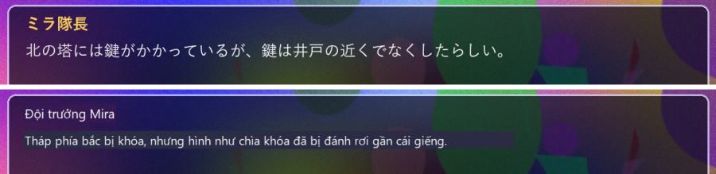
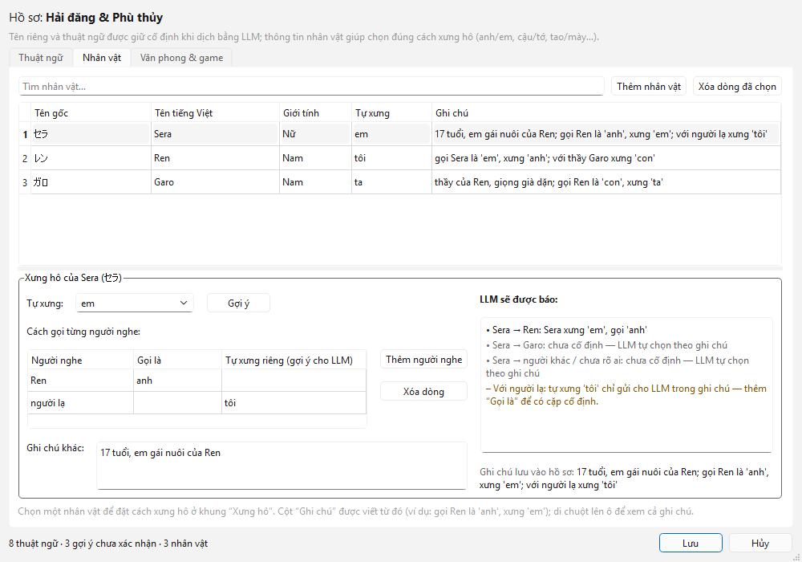
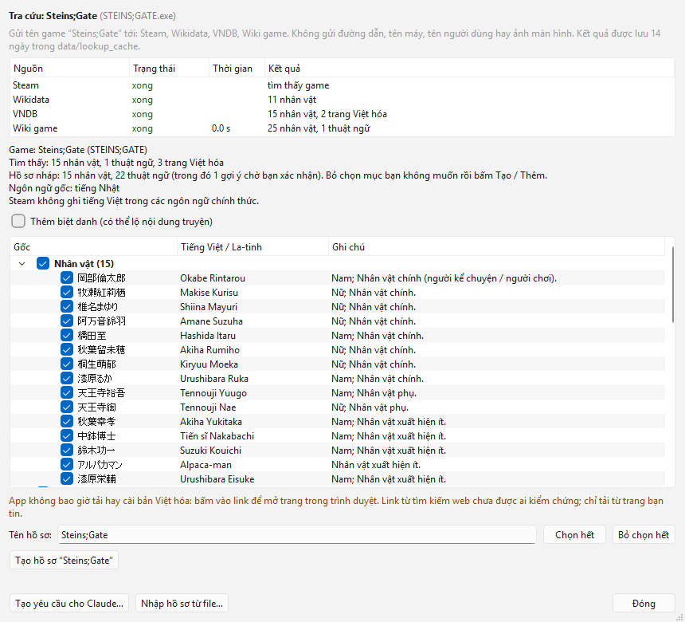

# Screen Translator

Screen Translator dịch chữ trên màn hình máy tính sang tiếng Việt ngay trong lúc bạn chơi game hay xem video có phụ đề. Bạn chọn một vùng màn hình (khung thoại visual novel, phụ đề, menu), app liên tục đọc chữ tiếng Nhật hoặc tiếng Anh trong vùng đó rồi vẽ bản dịch tiếng Việt đè lên đúng chỗ, giống Google Lens nhưng tự cập nhật theo màn hình. Bản dịch lấy từ Google; nếu máy có GPU NVIDIA, một model dịch chạy ngay trên máy (LLM, mô hình ngôn ngữ lớn) sẽ tinh chỉnh lại để giữ đúng tên riêng và chọn cách xưng hô (anh/em, tao/mày, bà/cháu…) theo từng nhân vật.

**Phiên bản 1.0.0** (2026-10-25) · Chỉ chạy trên Windows · Giấy phép [MIT](LICENSE) · [Nhật ký thay đổi](CHANGELOG.md)

Chưa có bộ cài .exe: bạn cài bằng cách dán vài lệnh vào PowerShell theo mục [*Cài app*](#cài-app) (tải khoảng 2 GB, thêm 2–6,7 GB nếu cài LLM).



*Trên: khung thoại gốc, lấy từ bộ ảnh mẫu của bộ test. Dưới: một bản dịch mẫu (soạn sẵn), vẽ bằng đúng đoạn code vẽ bản dịch của app.*

## Tính năng

- **Dịch một vùng màn hình liên tục**, tiếng Nhật hoặc tiếng Anh sang tiếng Việt. Bản dịch nằm trên một ô cùng màu nền, đè lên chữ gốc; một phím tắt ẩn / hiện bản dịch để xem chữ gốc.
- **Không đọc nhầm chữ của chính app**: bản dịch và mọi cửa sổ của app được ẩn khỏi ảnh chụp màn hình (cả video quay và stream), nên app không dịch lại chúng.
- **Google trước, LLM trên máy tinh chỉnh sau** (tùy chọn): bản Google hiện ngay, khoảng nửa giây đến một giây sau được thay tại chỗ bằng bản của model dịch Hy-MT2 (của Tencent, tải miễn phí từ Hugging Face) chạy trên GPU của bạn. Không cài LLM thì app dịch bằng Google.
- **Hồ sơ cho từng game**: thuật ngữ cố định, nhân vật, cách xưng hô và văn phong. App tự chuyển hồ sơ khi bạn mở game đó.
- **Giữ đúng xưng hô theo vai**: khi bản dịch đặt đại từ sai người (ví dụ em gái lại xưng "anh"), app tự sửa hoặc hỏi lại LLM, nhưng chỉ khi chắc chắn.
- **Chọn cách xưng hô bằng bảng** trong thẻ *Nhân vật*, có gợi ý sẵn, không cần gõ tay.
- **Hồ sơ mẫu Blue Archive** có sẵn: 73 thuật ngữ, 107 nhân vật.
- **Tra cứu game mới**: với game chưa có hồ sơ, app hỏi bạn một lần rồi tra Steam, Wikidata, VNDB và wiki của game để dựng sẵn hồ sơ nháp (tên nhân vật, giới tính, địa danh) và tìm link bản Việt hóa. Có thể tạo sẵn một yêu cầu để dán cho Claude (claude.ai) hay một trợ lý AI khác, rồi nhập lại hồ sơ.
- **Không can thiệp vào game**: app chỉ chụp màn hình như phần mềm quay video, không inject, không đọc bộ nhớ game. Khi bạn đang chơi một game có anti-cheat trong danh sách, app tạm dừng chụp màn hình.
- **Dùng như một app bình thường**: shortcut không kèm cửa sổ dòng lệnh, biểu tượng 文 ở khay hệ thống, chỉ chạy một bản, cửa sổ *Cài đặt*, *Hướng dẫn nhanh* ở lần mở đầu, giao diện tiếng Việt.

## Máy cần có

- Windows 11 24H2 trở lên.
- Python 3.12 bản 64-bit, có trình chạy `py` (bộ cài ở python.org có sẵn).
- Git for Windows (git-scm.com) để tải mã nguồn; không có thì tải ZIP (xem bước 1 của [*Cài app*](#cài-app)).
- GPU NVIDIA: không bắt buộc cho OCR (bước đọc chữ từ ảnh chụp màn hình), nhưng bắt buộc nếu muốn dịch bằng LLM trên máy.
  - OCR trên GPU dùng CUDA 13 nên cần driver NVIDIA r580 trở lên. Máy không có GPU NVIDIA hoặc driver cũ hơn thì app tự chạy OCR bằng CPU (chậm hơn nhiều).
  - Script cài LLM tự chọn bản CUDA 13.4 hoặc 12.4 theo driver.
- Ổ đĩa: venv của app chiếm khoảng 2,5 GB. LLM (tùy chọn) tải thêm khoảng 2 GB nếu chỉ lấy bản 1.8B, hoặc 6,7 GB cho cả bản 1.8B và 7B.
- VRAM cho LLM: bản 1.8B cần khoảng 2 GB, bản 7B khoảng 5,3 GB (ở chế độ tự động, app chỉ chọn 7B khi còn trống từ 7,5 GB VRAM).
- Mạng: để cài, để dịch bằng Google, và ở lần mở đầu tiên (app tải model OCR).

Kiểm tra nhanh trong PowerShell: `py -3.12 --version` phải in ra *Python 3.12.x*; `nvidia-smi` cho biết *Driver Version* (cần từ 580 trở lên).

## Cài app

Làm một lần, theo thứ tự dưới đây, trong PowerShell (bấm Start, gõ *PowerShell*, mở *Windows PowerShell*). Dán **từng khối lệnh** vào PowerShell rồi nhấn Enter, đợi khối đó chạy xong rồi mới dán khối sau. Chỗ nào ghi **chọn một** thì chỉ dán một khối.

**1. Lấy mã nguồn** về một đường dẫn ngắn (shortcut không nhận đường dẫn quá 260 ký tự). Thư mục này là *thư mục app*, mặc định `%USERPROFILE%\overlay-ocr`:

```powershell
cd $env:USERPROFILE
git clone https://github.com/dungbeo13/overlay-ocr
cd overlay-ocr
```

Không có git: trên trang GitHub bấm *Code → Download ZIP*, giải nén, đổi tên thư mục chứa tệp `run.ps1` (tên gốc là `overlay-ocr-main`) thành `overlay-ocr` rồi chuyển nó vào thư mục người dùng (dán `%USERPROFILE%` vào thanh địa chỉ của File Explorer để mở thư mục này). Sau đó chạy `cd $env:USERPROFILE\overlay-ocr` trong PowerShell.

**2. Tạo venv và cài thư viện.** venv là một môi trường Python riêng của app, để thư viện của app không lẫn với Python khác trên máy. venv phải nằm ở đường dẫn ngắn: OpenCV và các DLL CUDA/cuDNN sẽ không load được khi đường dẫn vượt 260 ký tự.

```powershell
py -3.12 -m venv $env:USERPROFILE\.venvs\screen-translator
$py = "$env:USERPROFILE\.venvs\screen-translator\Scripts\python.exe"
& $py -m pip install -r requirements.txt
```

pip tải khoảng 1,5–2 GB, phần lớn là thư viện CUDA/cuDNN cho OCR; venv chiếm khoảng 2,5 GB. `requirements.lock.txt` ghi lại đúng phiên bản đã kiểm chứng. Mọi lệnh `& $py …` trong README đều chạy từ thư mục app, với `$py` trỏ tới Python trong venv như trên. Các bước sau làm tiếp trong cùng cửa sổ PowerShell; lần sau mở cửa sổ mới thì xem [mục dưới](#mỗi-lần-mở-cửa-sổ-powershell-mới).

**3. (Tùy chọn) LLM trên máy** (llama.cpp và model Hy-MT2, nằm trong `%USERPROFILE%\.screen-translator`). **Chọn một** trong hai khối.

Card màn hình trên 8 GB VRAM: cài cả bản Nhẹ 1.8B và Chất lượng 7B (tải khoảng 6,7 GB):

```powershell
& $py -m tools.setup_llm
```

Card 8 GB VRAM trở xuống: chỉ cài bản Nhẹ 1.8B (tải khoảng 2 GB). Ở chế độ tự động, app chỉ chọn bản 7B khi còn trống từ 7,5 GB VRAM, nên với card này app gần như luôn dùng bản 1.8B khi bạn đang chơi:

```powershell
& $py -m tools.setup_llm --models light
```

Không cài thì app dịch bằng Google (cần mạng). Có thể cài sau: *Hướng dẫn nhanh* và *Cài đặt* → *Dịch* đều hiện lệnh này, kèm nút *Sao chép lệnh*. Chi tiết ở mục [*Dịch bằng LLM trên máy*](#dịch-bằng-llm-trên-máy).

**4. (Tùy chọn) SearXNG trên máy**, để phần tra cứu game mới tìm được trang Việt hóa và wiki trên web: `& $py -m tools.setup_searxng` (xem mục [*SearXNG trên máy*](#searxng-trên-máy-tùy-chọn)).

**5. Tạo shortcut** Desktop và Start Menu (hoặc bấm đúp `Tạo lại shortcut.cmd` trong thư mục app):

```powershell
& $py -m tools.install_shortcut
```

Xong. Mở app theo mục [*Bắt đầu nhanh*](#bắt-đầu-nhanh). Lần mở đầu tiên, RapidOCR tự tải các model OCR, nên cần mạng. Muốn chạy app kèm cửa sổ dòng lệnh thay cho shortcut: xem [*Chạy từ dòng lệnh*](#chạy-từ-dòng-lệnh).

### Mỗi lần mở cửa sổ PowerShell mới

Các lệnh `& $py …` ở những mục khác (shortcut, SearXNG, cài LLM sau, cập nhật, gỡ app) cần PowerShell đang ở thư mục app và biết `$py`. Mỗi lần mở cửa sổ PowerShell mới, dán 2 dòng này trước rồi mới chạy lệnh của app:

```powershell
cd $env:USERPROFILE\overlay-ocr
$py = "$env:USERPROFILE\.venvs\screen-translator\Scripts\python.exe"
```

Nếu bạn để thư mục app hay venv ở chỗ khác thì sửa đường dẫn cho đúng.

### Shortcut

Shortcut tên *Screen Translator* nằm ngoài Desktop và trong Start Menu. Nó mở app không kèm cửa sổ dòng lệnh: app chỉ hiện biểu tượng 文 ở khay hệ thống. Mặc định app không khởi động cùng Windows; bật trong *Cài đặt* → *Chung*, hoặc dùng lệnh. Mỗi dòng dưới đây là một lệnh riêng, chỉ chạy dòng bạn cần:

| Lệnh | Việc |
|---|---|
| `& $py -m tools.install_shortcut` | Tạo / cập nhật shortcut Desktop + Start Menu |
| `& $py -m tools.install_shortcut --startup` | Như trên, thêm shortcut khởi động cùng Windows (thư mục Startup) |
| `& $py -m tools.install_shortcut --check` | Xem các shortcut đang trỏ tới đâu |
| `& $py -m tools.install_shortcut --remove` | Gỡ shortcut Desktop + Start Menu (thêm `--startup` để gỡ cả shortcut Startup) |

Shortcut trỏ tới đúng thư mục app và venv lúc tạo. Nếu chuyển thư mục app sang chỗ khác hoặc tạo lại venv, **bấm đúp `Tạo lại shortcut.cmd`** trong thư mục app. Chạy lại lúc nào cũng được: shortcut đã đúng thì không đổi gì.

## Bắt đầu nhanh

**1. Mở app** bằng shortcut *Screen Translator*. App không có cửa sổ chính: nó chạy ở khay hệ thống, biểu tượng 文 ở góc phải thanh tác vụ (có thể nằm sau mũi tên ^). Lần mở đầu tiên, cửa sổ *Hướng dẫn nhanh* tự mở. Những lần sau, một thông báo nhỏ báo *Screen Translator đang chạy* (hoặc nhắc cách chọn vùng, nếu chưa chọn vùng nào).

**2. Làm theo Hướng dẫn nhanh.** Có 6 bước ngắn, bước nào cũng bỏ qua được; Enter là *Tiếp*:

1. App làm gì, và lưu ý về anti-cheat.
2. Chọn ngôn ngữ nguồn.
3. Chọn hoặc tạo hồ sơ game (hồ sơ tự bật theo tên tệp .exe của game).
4. Chọn vùng dịch: mở game trước, để khung thoại hiện trên màn hình, rồi bấm *Chọn vùng ngay* (hoặc bỏ qua và chọn sau bằng Ctrl+Alt+R).
5. Bảng phím tắt.
6. Tình trạng LLM: đã cài / đang tải / chưa có, kèm lệnh cài `tools.setup_llm`.

Mở lại bằng khay → *Hướng dẫn nhanh…*, nút trong *Cài đặt* → *Chung*, hoặc `--first-run`. Đóng app khi hướng dẫn còn mở thì lần sau nó vẫn tự mở.

**3. Chọn vùng dịch** (bỏ qua nếu đã chọn ở bước 4 của Hướng dẫn nhanh). Mở game (nên để game ở chế độ cửa sổ *Windowed* hoặc cửa sổ không viền *Borderless*), để khung thoại hiện trên màn hình, nhấn **Ctrl+Alt+R** rồi kéo chuột quanh khung thoại (Esc để hủy). Vùng được lưu lại cho lần sau. App chỉ nhớ một vùng: đổi sang game khác thì chọn lại. Từ đó, mỗi khi chữ trong vùng thay đổi, app tự dịch và vẽ bản dịch đè lên.

**4. Đọc chữ gốc khi cần**: Ctrl+Alt+H ẩn / hiện bản dịch, Ctrl+Alt+T tạm dừng / tiếp tục. Muốn biết LLM có đang chạy không: mở menu khay, xem dòng *LLM: …* (*LLM: sẵn sàng (…)* là LLM đang tinh chỉnh bản dịch; *LLM: chưa có model* là app đang dịch bằng Google).

### Phím tắt

| Phím tắt | Việc |
|---|---|
| Ctrl+Alt+R | Chọn vùng dịch (kéo chuột, Esc để hủy). Vùng được lưu lại |
| Ctrl+Alt+T | Tạm dừng / tiếp tục |
| Ctrl+Alt+H | Ẩn / hiện bản dịch (để xem chữ gốc) |
| Ctrl+Alt+L | Đổi ngôn ngữ nguồn Nhật ↔ Anh |
| Ctrl+Alt+Q | Thoát |

Đổi phím trong *Cài đặt* → *Phím tắt*.

### Menu khay

Bấm (chuột trái hoặc phải) vào biểu tượng 文 để mở menu, bấm đúp để chọn vùng dịch, bấm chuột giữa để tạm dừng / tiếp tục. Di chuột lên biểu tượng để xem phiên bản và trạng thái, ví dụ *Screen Translator 1.0.0 · JA→VI*.

Menu gồm, từ trên xuống:

- Dòng trạng thái.
- *Chọn vùng dịch*, *Tạm dừng*, *Ẩn bản dịch*, *Ngôn ngữ nguồn*.
- *Hồ sơ: <tên hồ sơ>*: chọn hồ sơ của game, *Tạo hồ sơ mới…*, *Sửa thuật ngữ / nhân vật…*.
- *Tra cứu game*.
- *Dịch bằng LLM: <chế độ>*: chế độ và các mục *Mô hình: …*. Ngay dưới là dòng trạng thái LLM, ví dụ *LLM: sẵn sàng (…)*.
- *Chế độ anti-cheat*.
- *Cài đặt…*, *Hướng dẫn nhanh…*, *Mở thư mục dữ liệu*, *Thoát*.

Màu biểu tượng: xanh dương là đang dịch; cam là đang tạm dừng vì bạn đang chơi game có anti-cheat; đỏ là có lỗi (di chuột lên biểu tượng để xem lỗi gì); xám là bạn đã tạm dừng hoặc chưa chọn vùng.

## Sử dụng

Các lệnh `& $py …` trong phần này chạy trong PowerShell, từ thư mục app. Mở cửa sổ PowerShell mới thì dán [2 dòng này](#mỗi-lần-mở-cửa-sổ-powershell-mới) trước.

### Chọn vùng

- Chọn lại vùng lúc nào cũng được: Ctrl+Alt+R, menu khay → *Chọn vùng dịch*, hoặc bấm đúp biểu tượng 文. Vùng nhỏ vừa khít khung thoại thì OCR nhanh hơn vùng lớn.
- Ở chế độ tiếng Nhật, đoạn chữ chỉ có ký tự Latin (menu, phụ đề tiếng Anh) sẽ được dịch như tiếng Anh.
- Đổi nhanh ngôn ngữ nguồn Nhật ↔ Anh bằng Ctrl+Alt+L.

### Chỉnh cách hiện bản dịch

*Cài đặt* → *Hiển thị*: phông chữ, cỡ chữ nhỏ nhất, độ che chữ gốc (0 % = trong suốt, 100 % = che kín) và khung viền vùng dịch, kèm ô xem trước vẽ bản dịch lên một khung thoại giả đúng như app vẽ. Ctrl+Alt+H ẩn / hiện bản dịch để xem chữ gốc.

### Dịch bằng LLM trên máy

App chạy một model dịch trên GPU của bạn bằng llama-server; nó chỉ nhận kết nối từ chính máy bạn (127.0.0.1). Model nhận cùng lúc mọi dòng chữ đang hiện trong vùng dịch, kèm thuật ngữ của hồ sơ, danh sách nhân vật và các câu thoại gần đây. Nhờ vậy tên riêng được giữ cố định, còn cách xưng hô (anh/em, tao/mày, bà/cháu…) đi theo người nói và người nghe.

- **Chế độ** (khay → *Dịch bằng LLM*, hoặc *Cài đặt* → *Dịch*, hoặc `--llm-mode`):
  - *Google trước, LLM tinh chỉnh* (mặc định): bản Google hiện ngay, khoảng 0,5–1 s sau được thay tại chỗ bằng bản LLM, không bị nháy trống.
  - *Chỉ LLM*: chờ bản LLM; nếu LLM chưa sẵn sàng hoặc quá thời gian thì dùng Google.
  - *Tắt*.
- **Mô hình** (khay → *Dịch bằng LLM* → các mục *Mô hình: …*, hoặc *Cài đặt* → *Dịch* → *Mô hình*, hoặc `--llm-model light|quality`):
  - *Tự động* (mặc định): dùng *Chất lượng 7B* (cần thêm khoảng 5,3 GB VRAM) khi còn trống từ 7,5 GB VRAM, nếu không thì dùng *Nhẹ 1.8B*.
  - *Nhẹ 1.8B* (khoảng 2 GB VRAM) chỉ tinh chỉnh câu thoại và phụ đề; chữ trên menu, nút bấm của game vẫn do Google dịch.
- **Vòng đời:**
  - Server tải model khoảng 2 s.
  - Server tự tắt (trả VRAM) sau 30 s khi bạn đang chơi game có anti-cheat, và sau 10 phút không dùng. Lần sau cần thì tự bật lại.
  - Khi app thoát, không còn process llama-server nào sót lại.
  - Ngữ cảnh hội thoại tự reset sau 3 phút im lặng hoặc khi đổi vùng.
- **Cài hoặc cài lại:** `& $py -m tools.setup_llm` tải những gì còn thiếu (thêm `--models light` để chỉ lấy bản 1.8B), `--verify` kiểm lại các file đã cài, `--force` tải lại hết. Mọi thứ nằm trong `%USERPROFILE%\.screen-translator`. Cài xong thì thoát app (Ctrl+Alt+Q) rồi mở lại.

Chi tiết, kể cả bản llama.cpp và model đang dùng: [Hướng dẫn chi tiết](docs/huong-dan-chi-tiet.md#dịch-bằng-llm-local-glossary--ngữ-cảnh).

### Hồ sơ game: thuật ngữ, nhân vật, xưng hô

Mỗi game nên có một hồ sơ riêng (`data/profiles/*.json`). Mở bằng khay → *Hồ sơ* → *Sửa thuật ngữ / nhân vật…*: cửa sổ *Thuật ngữ & nhân vật* có ba thẻ.

- *Thuật ngữ*: tên riêng và thuật ngữ cố định.
- *Nhân vật*: tên tiếng Việt, giới tính, cách tự xưng, ghi chú quan hệ (ví dụ: *gọi Ren là "anh", xưng "em"*).
- *Văn phong & game*: văn phong, ngôn ngữ nguồn của game, và các tệp .exe của game để app **tự chuyển sang hồ sơ này** khi bạn mở game. Mở game trước, rồi bấm *Thêm cửa sổ đang mở…* để lấy đúng tên tệp.

Tên do LLM đề xuất được thêm vào thẻ *Thuật ngữ* với nền vàng. Chúng chỉ là gợi ý cho LLM cho tới khi bạn bấm *Xác nhận*. Xóa một gợi ý sai thì các bản dịch đã lưu sẵn có dùng gợi ý đó cũng bị xóa, lần sau sẽ được dịch lại.

**Thẻ Nhân vật: chọn cách xưng hô.** Chọn một nhân vật ở bảng trên (ô *Tìm nhân vật…* lọc theo tên và ghi chú). Khung **Xưng hô** bên dưới có:

- **Tự xưng**: cách nhân vật tự gọi mình (tôi, em, anh, tớ, ta…), chọn trong danh sách hoặc gõ.
- **Cách gọi từng người nghe**: mỗi dòng một người nghe (một nhân vật khác, hoặc một nhóm như *khách*, *người lạ*, *mọi người*); cột *Gọi là* là từ dùng để gọi người đó (anh, em, cậu, mày, Sensei…).
- **Gợi ý**: điền sẵn các ô còn trống khi app đoán được, theo vai trò trong ghi chú, theo cách người nghe tự xưng hoặc theo giới tính.
- **LLM sẽ được báo**: các cặp xưng hô cố định app gửi kèm mỗi câu thoại, ví dụ *Sera → Ren: Sera xưng 'em', gọi 'anh'*.

Mỗi nhân vật cần **Tên gốc** viết đúng như chữ trong game (ví dụ セラ); chỉ có *Tên tiếng Việt* thì app không nhận ra nhân vật. Khi bạn đổi tên một nhân vật, những dòng xưng hô của nhân vật khác đang gọi tên cũ cũng tự đổi theo. Chi tiết từng ô và những trường hợp không lưu được: [Hướng dẫn chi tiết](docs/huong-dan-chi-tiet.md#chọn-cách-xưng-hô-thẻ-nhân-vật).



### Hồ sơ Blue Archive

- Hồ sơ mẫu nằm ở [`profiles/templates/blue_archive.json`](profiles/templates/blue_archive.json). Lần đầu bạn mở BlueArchive.exe, app đề nghị dùng hồ sơ này (hoặc chọn khay → *Tra cứu game*). Bấm dùng thì app chép nó vào `data/profiles/`.
- Hồ sơ có 73 thuật ngữ (Kivotos, Schale, Pyroxene, MomoTalk, tên trường, tên CLB…) và 107 nhân vật (Sensei, Arona, Plana, Black Suit và 103 học sinh), soạn từ dữ kiện công khai trên wiki, không lấy từ tệp của game. Với BA, app chỉ chụp màn hình rồi OCR, không hook và không đọc bộ nhớ game.
- Học sinh xưng **em** và gọi **Sensei**. Game không nêu giới tính của Sensei, nên mặc định Sensei xưng **tôi**.
- **Đổi Sensei thành thầy/em:**
  1. Khay → *Hồ sơ* → *Sửa thuật ngữ / nhân vật…* → thẻ **Nhân vật** → chọn dòng 先生 (Sensei).
  2. Ở bảng trên, đặt cột *Giới tính* là *Nam*. Trong khung **Xưng hô**, đặt *Tự xưng* là `thầy`.
  3. Ở bảng *Cách gọi từng người nghe*, dòng *học sinh*: sửa ô *Tự xưng riêng (gợi ý cho LLM)* từ `tôi (không xưng 'anh', 'thầy' hay 'cô')` thành `thầy (không xưng 'tôi' hay 'anh')`.
  4. Bấm *Lưu*.

  Muốn Sensei là cô giáo thì làm như trên với *Nữ* và `cô` (thay cho *Nam* và `thầy`). Lưu ý: khi đó model 7B cũng hay để học sinh gọi Sensei là "thầy" (2 trên 3 câu thử).
- Nên dùng model 7B. Bản 1.8B thường dịch 先生 thành "Thầy".
- Mọi cách dịch tiếng Việt trong hồ sơ chỉ là đề xuất (BA không có bản tiếng Việt chính thức); sửa theo ý bạn trong *Sửa thuật ngữ / nhân vật…*.
- Chưa kiểm chứng: tên tệp .exe của client PC Yostar JP (lúc đang chơi, mở thẻ *Văn phong & game* của hồ sơ, bấm *Thêm cửa sổ đang mở…* rồi chọn cửa sổ game) và bố cục hộp thoại so với ảnh chụp thật. Nếu chơi bản Global tiếng Anh: trong thẻ đó, đặt *Ngôn ngữ nguồn* là *Tiếng Anh*. Chi tiết: [Hướng dẫn chi tiết](docs/huong-dan-chi-tiet.md#hồ-sơ-blue-archive).

### Game có anti-cheat

App không inject và không đọc bộ nhớ game. Mỗi giây app chỉ xem tên tệp .exe của cửa sổ bạn đang dùng. Nếu game nằm trong danh sách anti-cheat, app xử lý theo chế độ (đổi ở *Cài đặt* → *Anti-cheat* hoặc khay → *Chế độ anti-cheat*):

- *Tạm dừng* (mặc định): ngừng chụp màn hình, xóa bản dịch đang hiện, tự chạy lại khi bạn rời game.
- *Chỉ cảnh báo*: báo một lần, vẫn tiếp tục dịch.
- *Tắt*: không kiểm tra gì.

Thêm game của bạn: *Cài đặt* → *Anti-cheat* → *Thêm từ cửa sổ đang mở…* (hoặc gõ tên tệp .exe rồi bấm *Thêm*); ở đó cũng xóa được game khỏi danh sách hay khôi phục danh sách mặc định. Danh sách mặc định có các game online như VALORANT, Fortnite, Apex Legends, CS2, Dota 2, Genshin Impact, Honkai: Star Rail, Zenless Zone Zero, League of Legends, PUBG. **Blue Archive không có trong danh sách mặc định** (xem [câu hỏi về khóa tài khoản](#câu-hỏi-thường-gặp--xử-lý-sự-cố)). Khi bạn đang chơi game có anti-cheat, LLM tự tắt sau 30 giây để trả VRAM cho game, và tự bật lại khi cần.

### Tra cứu game mới

Khi bạn mở một game chưa có hồ sơ, app có thể tra dữ liệu cộng đồng **một lần** để dựng sẵn hồ sơ thuật ngữ: tên nhân vật, giới tính, họ / tên gọi tắt, địa danh, tổ chức. Không tìm thấy gì thì app chạy như trước.

- App chỉ hiện **một** thông báo nhỏ ở khay (*Game mới: <tên>…*), không mở cửa sổ đè lên game, kể cả game có anti-cheat. Game đó cũng nằm trong mục **Tra cứu game** của menu khay.
- **Hỏi trước, mỗi game một lần.** Chưa gửi gì lên mạng cho tới khi bạn bấm *Tra cứu*. Thứ được gửi đi là tên game (sửa được trong cửa sổ hỏi) và mã Steam nếu có, tới Steam, Wikidata, VNDB, wiki của game và SearXNG. Không gửi đường dẫn, tên thư mục cá nhân, tên người dùng hay tên máy.
- App nhận ra game chỉ bằng tệp trên đĩa (tên sản phẩm trong tệp .exe, tệp của Steam, tên thư mục, tệp đánh dấu engine), không đụng tới process của game.
- Kết quả hiện trong một cửa sổ để bạn bỏ chọn mục không muốn, rồi *Tạo hồ sơ* hoặc *Thêm vào hồ sơ*. Mục bạn đã có được giữ nguyên. Biệt danh (có thể lộ nội dung truyện) mặc định không thêm.
- **Bản Việt hóa: app chỉ hiện đường link**, không tải hay cài gì. Link từ tìm kiếm web nằm riêng, ghi *chưa kiểm chứng*.
- Game khớp một hồ sơ mẫu (như Blue Archive) thì app dùng luôn hồ sơ mẫu, không lên mạng.
- *Tạo yêu cầu tra cứu cho Claude…* tạo sẵn một đoạn yêu cầu (không lên mạng) để bạn dán cho Claude (claude.ai) hay một trợ lý AI khác. Câu trả lời nhập lại bằng *Nhập hồ sơ từ file…* hoặc *Dán hồ sơ từ clipboard…*.
- Không muốn được hỏi nữa: *Cài đặt* → *Tra cứu game* → bỏ chọn *Hỏi khi gặp game mới*.

Nguồn dữ liệu và giấy phép, cách dựng hồ sơ nháp, kết quả thử thật và dòng lệnh `tools.lookup_game`: [Tra cứu game mới và SearXNG](docs/tra-cuu-game.md).



#### SearXNG trên máy (tùy chọn)

Khi tra cứu một game, app có thể tìm thêm trên web: trang bản Việt hóa (“<tên game> Việt hóa”) hay wiki của game. Việc tìm này đi qua SearXNG, một máy tìm kiếm gộp mã nguồn mở chạy ngay trên máy bạn, không cần API key và không mất phí. Không có SearXNG thì app vẫn tra cứu bằng Steam, Wikidata, VNDB và wiki như thường, chỉ thiếu phần tìm trên web.

Cài bằng *Cài đặt* → *Tra cứu game* → *Cài SearXNG trên máy…*, hoặc bằng lệnh. Mỗi dòng dưới đây là một lệnh riêng, chỉ chạy dòng bạn cần:

| Lệnh | Việc |
|---|---|
| `& $py -m tools.setup_searxng` | Cài hoặc sửa, chạy thử, rồi điền `searxng_url` vào `data/config.json` |
| `& $py -m tools.setup_searxng --verify` | Kiểm tra lại: mã nguồn, khởi động, một lần tìm JSON, tắt |
| `& $py -m tools.setup_searxng --status` | Đã cài chưa, có đang trả lời không |
| `& $py -m tools.setup_searxng --remove` | Gỡ SearXNG |

App chỉ bật SearXNG khi đang tra cứu một game, chỉ cho nó nhận kết nối từ chính máy bạn (127.0.0.1), và tắt nó sau 10 phút không dùng hoặc khi app thoát. SearXNG dùng khoảng 90–105 MB RAM, không dùng GPU. Chi tiết: [Tra cứu game mới và SearXNG](docs/tra-cuu-game.md#searxng-trên-máy-tùy-chọn).

### Cửa sổ Cài đặt

**Cài đặt** (khay → *Cài đặt…*): cửa sổ riêng, app vẫn dịch trong lúc mở; nút *Lưu*, *Hủy*, *Mặc định*. *Mặc định* hỏi lại trước, chỉ điền lại các ô (bấm *Lưu* mới áp dụng) và không đổi *Khởi động cùng Windows*.

| Tab | Gồm |
|---|---|
| Chung | Ngôn ngữ nguồn, *Khởi động cùng Windows*, *Hướng dẫn nhanh…* |
| Dịch | Chế độ LLM, mô hình, số câu thoại gần đây gửi kèm, tự thêm thuật ngữ LLM đề xuất, tắt LLM để giải phóng VRAM khi đang chơi game có anti-cheat. Khi chưa cài LLM: lệnh cài kèm nút *Sao chép lệnh* |
| Hiển thị | Phông chữ, cỡ chữ nhỏ nhất, độ che chữ gốc (0 % = trong suốt, 100 % = che kín), khung viền vùng dịch, kèm ô xem trước vẽ bản dịch lên một khung thoại giả đúng như app vẽ |
| Phím tắt | Bấm vào ô rồi nhấn tổ hợp mới (Esc: hủy, Backspace hoặc nút *Xóa phím*: bỏ phím). Báo phím trùng nhau, phím Windows dùng (Alt+F4, Win+L…) và phím thiếu Ctrl / Alt / Win |
| Anti-cheat | Chế độ và danh sách game: thêm từ cửa sổ đang mở, gõ tên tệp .exe, xóa, khôi phục danh sách mặc định |
| Nâng cao | Chu kỳ chụp, thiết bị OCR, cách chụp màn hình, mở thư mục dữ liệu |
| Tra cứu game | Hỏi khi gặp game mới, các nguồn tra cứu, SearXNG (địa chỉ, *Kiểm tra*, *Cài SearXNG trên máy…*), *Tạo yêu cầu cho Claude…*, nhập hồ sơ, *Quên các game đã hỏi* |

- Phần lớn thay đổi áp dụng ngay khi bấm *Lưu*. Đổi thiết bị OCR hoặc cách chụp màn hình thì cần khởi động lại app: cửa sổ hiện nút *Khởi động lại app*.
- Mọi thứ vẫn lưu trong `data/config.json`; sửa tay khi app đã tắt vẫn được. Giá trị sửa tay mà app vẫn chạy được (ví dụ phím F9 không có Ctrl, chu kỳ 30 ms) được giữ nguyên: cửa sổ chỉ báo, không bắt sửa trước khi lưu thứ khác.
- Tab *Chung* ghi phiên bản app đang chạy (*Phiên bản 1.0.0*).

Chi tiết: [Hướng dẫn chi tiết](docs/huong-dan-chi-tiet.md#mở-app-không-cần-cửa-sổ-dòng-lệnh-cửa-sổ-cài-đặt-và-hướng-dẫn-nhanh).

### Dữ liệu và gỡ app

- Dữ liệu nằm trong `data/`:
  - `config.json`: cài đặt.
  - `cache.sqlite3`: cache bản dịch.
  - `logs/app.log`: log.
- `data/profiles/`: hồ sơ của từng game. `data/lookup_state.json`: các game app đã hỏi về tra cứu. `data/lookup_cache/`: kết quả tra cứu (giữ 14 ngày).
- `%USERPROFILE%\.screen-translator`: llama.cpp, các model LLM và SearXNG (nếu đã cài).
- `%USERPROFILE%\.venvs\screen-translator`: venv của app.

`data/` nằm trong thư mục app, là dữ liệu riêng của bạn và không có trong repo. Mở nhanh bằng menu khay → *Mở thư mục dữ liệu*.

**Gỡ app:**

1. Thoát app (Ctrl+Alt+Q, hoặc menu khay → *Thoát*).
2. Mở PowerShell ở thư mục app ([2 dòng này](#mỗi-lần-mở-cửa-sổ-powershell-mới)), rồi gỡ shortcut: `& $py -m tools.install_shortcut --remove --startup`.
3. Nếu đã cài SearXNG: `& $py -m tools.setup_searxng --remove`.
4. Xóa thư mục app (cùng `data/` bên trong), thư mục `%USERPROFILE%\.screen-translator` và venv `%USERPROFILE%\.venvs\screen-translator`.

### Chạy từ dòng lệnh

Muốn chạy có cửa sổ dòng lệnh (để xem log ngay, hoặc thử một vùng khác chỉ cho lần chạy này), mở PowerShell ở thư mục app rồi chạy **một** trong các lệnh sau:

| Lệnh | Việc |
|---|---|
| `.\run.ps1` | Dịch vùng đã lưu; lần đầu nhấn Ctrl+Alt+R để chọn vùng |
| `.\run.ps1 --lang en --region 0,1040,2560,400` | Tham số dòng lệnh chỉ áp dụng cho lần chạy này |
| `.\run.ps1 --help` | Xem mọi tham số |
| `.\run.ps1 --version` | In phiên bản đang dùng |
| `& $py -m app` | Giống `.\run.ps1`, chạy thẳng bằng Python của venv |

- `--region trái,trên,rộng,cao`, tính bằng pixel thật của màn hình.
- `.\run.ps1` là script PowerShell. Windows mặc định không cho chạy script PowerShell (.ps1); nếu PowerShell báo *running scripts is disabled on this system* thì chạy `powershell -ExecutionPolicy Bypass -File .\run.ps1` (tham số thêm phía sau như thường), hoặc dùng `& $py -m app`.

## Câu hỏi thường gặp / Xử lý sự cố

**Đã chọn vùng mà không thấy bản dịch?**
Di chuột lên biểu tượng 文 để xem trạng thái, rồi kiểm tra lần lượt:
- Biểu tượng màu cam: game nằm trong danh sách anti-cheat nên app đang tạm dừng (xem [Game có anti-cheat](#game-có-anti-cheat)). Màu xám: bạn đã tạm dừng (Ctrl+Alt+T) hoặc chưa chọn vùng. Màu đỏ: có lỗi, trạng thái ghi lỗi gì.
- Bản dịch đang bị ẩn: nhấn Ctrl+Alt+H.
- Lần mở đầu tiên app còn đang tải model OCR (trạng thái *Đang tải OCR…*), hoặc máy mất mạng (Google cần mạng; trạng thái báo *Lỗi dịch: …*).
- Game chạy toàn màn hình (*Fullscreen*) có thể che mất bản dịch: trong phần cài đặt đồ họa của game, chọn *Windowed* (cửa sổ) hoặc *Borderless* (cửa sổ không viền).
- Chọn lại vùng (Ctrl+Alt+R) cho vừa khít khung thoại.

**Mở app mà không thấy cửa sổ nào hiện ra?**
App không có cửa sổ chính: nó chạy ở khay hệ thống, biểu tượng 文 ở góc phải thanh tác vụ (có thể nằm sau mũi tên ^). *Hướng dẫn nhanh* chỉ tự mở ở lần đầu. Mở app thêm lần nữa thì không có bản thứ hai: app đang chạy báo *App đang chạy ở khay hệ thống* và mở menu khay. Nếu bản đầu còn đang khởi động (máy vừa bật, ổ đĩa chậm), lần mở thứ hai chờ nó tới 45 giây. Chỉ khi app thật sự bị treo mới có thông báo *đang chạy nhưng không phản hồi*: đợi một lát rồi mở lại; nếu vẫn vậy, tắt “pythonw.exe” trong Task Manager rồi mở lại app.

**Có mất phí, có cần tài khoản Google không?**
Không. App dùng Google Dịch qua một địa chỉ miễn phí, không chính thức (chỉ nên dùng cho cá nhân), không cần tài khoản hay key. Ở chế độ mặc định, chữ trong vùng dịch được gửi tới Google để dịch. LLM trên máy cũng miễn phí và chạy hoàn toàn trên máy bạn.

**Chưa cài LLM thì sao?**
App dịch bằng Google (cần mạng). Muốn cài LLM: mở *Cài đặt* → *Dịch*, bấm *Sao chép lệnh*, dán vào PowerShell rồi nhấn Enter. Lệnh đã có sẵn đường dẫn và cài cả hai bản; muốn chỉ bản Nhẹ 1.8B thì thêm ` --models light` vào cuối dòng. Cài xong, thoát app (Ctrl+Alt+Q) rồi mở lại.

**App có làm game giật không?**
Trong lần chạy thử trên máy của tác giả (chưa có LLM), app dùng trung bình 8–10 % của một nhân CPU, khoảng 1,3 GB RAM và 1 GB VRAM ([số đo](docs/ket-qua-do.md#kết-quả-phase-1-2026-10-23)). LLM cần thêm khoảng 2 GB VRAM (bản 1.8B) hoặc 5,3 GB (bản 7B): game thiếu VRAM thì chọn *Mô hình: Nhẹ 1.8B* hoặc tắt LLM. Ảnh hưởng tới FPS chưa được đo trên game thật.

**Dùng app với game có anti-cheat (Blue Archive, Genshin…) có bị khóa tài khoản không?**
App không inject, không đọc bộ nhớ game; nó chỉ chụp màn hình như phần mềm quay video. Dù vậy, không ai đảm bảo được mọi anti-cheat đều chấp nhận, và phần tự dừng mới được kiểm thử tự động, chưa thử với game thật. Với game nằm trong danh sách (*Cài đặt* → *Anti-cheat*), app tự ngừng chụp. Blue Archive **không** nằm trong danh sách mặc định, nên app vẫn dịch khi bạn chơi BA. Muốn thận trọng thì thêm BlueArchive.exe vào danh sách (khi đó, ở chế độ *Tạm dừng* mặc định, app không dịch BA nữa).

**Đang chơi game thì app tự dừng dịch.**
Game đó nằm trong danh sách anti-cheat: app tạm dừng chụp, xóa bản dịch và tự chạy lại khi bạn rời game. Xem [Game có anti-cheat](#game-có-anti-cheat).

**Mỗi game một vùng dịch được không?**
Chưa: app nhớ một vùng cho mọi game. Đổi game thì nhấn Ctrl+Alt+R chọn lại.

**Cập nhật lên bản mới thế nào?**
Thoát app (Ctrl+Alt+Q). Cài bằng git: mở PowerShell ở thư mục app ([2 dòng này](#mỗi-lần-mở-cửa-sổ-powershell-mới)), chạy `git pull` rồi `& $py -m pip install -r requirements.txt`. Cài bằng ZIP: giải nén bản mới, **chép thư mục `data/` của bản cũ sang** (cài đặt, hồ sơ game và vùng dịch nằm ở đó), rồi bấm đúp `Tạo lại shortcut.cmd`. Thay đổi của từng bản: [CHANGELOG.md](CHANGELOG.md).

**Chuyển thư mục app (hoặc tạo lại venv) xong, shortcut không mở được app.**
Bấm đúp `Tạo lại shortcut.cmd` trong thư mục mới: shortcut Desktop, Start Menu (và Startup, nếu đang bật *Khởi động cùng Windows*) sẽ trỏ sang chỗ mới. Nếu shortcut có tham số sai, app báo bằng hộp thoại tiếng Việt và chỉ đúng cách này.

**PowerShell báo *'py' is not recognized* (hoặc *'git' is not recognized*).**
Máy chưa có Python 3.12 (hoặc thiếu trình chạy `py`): cài Python 3.12 bản 64-bit từ python.org, rồi mở cửa sổ PowerShell mới. Thiếu git thì cài Git for Windows, hoặc tải ZIP như ở bước 1 của [*Cài app*](#cài-app).

**PowerShell báo *running scripts is disabled on this system*.**
Windows mặc định không cho chạy script PowerShell (.ps1). Chạy `powershell -ExecutionPolicy Bypass -File .\run.ps1`, hoặc dùng `& $py -m app`, hoặc mở app bằng shortcut (shortcut không cần PowerShell).

**Máy không có GPU NVIDIA, hoặc driver NVIDIA cũ hơn r580.**
App tự chạy OCR bằng CPU (chậm hơn nhiều và tốn CPU hơn). Dịch bằng LLM trên máy cần GPU NVIDIA; không có thì app dịch bằng Google. Thiết bị OCR chọn được trong *Cài đặt* → *Nâng cao* (cần khởi động lại app).

**Sao ảnh chụp màn hình, video quay hay stream không thấy bản dịch?**
Bản dịch và mọi cửa sổ của app được ẩn khỏi ảnh chụp, video và stream (chỉ bạn thấy), để app không tự dịch lại chữ của mình. Muốn hỏi ai về một lỗi thì bấm *Sao chép chi tiết* trong hộp thoại lỗi rồi dán.

**Nhật ký (log) nằm ở đâu?**
`data/logs/app.log`. Lỗi xảy ra trước khi app kịp mở log nằm ở `data/logs/startup-error.log`; nếu app bị crash, chi tiết lỗi nằm ở `data/logs/crash.log` (của lần chạy trước: `crash.log.1`). SearXNG ghi vào `data/logs/searxng.log`. Hộp thoại lỗi có nút *Mở thư mục nhật ký*.

**Báo lỗi ở đâu?**
Mở một Issue trên [trang GitHub của dự án](https://github.com/dungbeo13/overlay-ocr/issues), dán nội dung *Sao chép chi tiết* và phần cuối `data/logs/app.log`. Đọc lại trước khi đăng: log có thể chứa đường dẫn có tên tài khoản Windows của bạn.

**App hỏi có tra cứu game mới không. App có gửi gì lên mạng không?**
Chưa gửi gì cho tới khi bạn bấm *Tra cứu*, và chỉ gửi tên game (cùng mã Steam nếu có). Mỗi game chỉ hỏi một lần. Bấm *Không hỏi lại game này*, hoặc tắt hẳn trong *Cài đặt* → *Tra cứu game*.

**Tên riêng bị dịch sai, ví dụ tên kanji hiếm bị dịch kiểu Hán-Việt (小鳥遊 → Tiểu Điểu Du).**
Thêm tên đó vào hồ sơ của game (khay → *Hồ sơ* → *Sửa thuật ngữ / nhân vật…*).

**Log hay báo "prompt too long".**
Hồ sơ nhiều nhân vật làm prompt dài; app tự bớt lịch sử hội thoại rồi gửi lại. Nếu vẫn hay gặp, đặt `"llm_ctx": 6144` trong `data/config.json` (sửa khi app đã tắt).

**Lần đầu mở app có cần mạng không?**
Có: lần mở đầu tiên, RapidOCR tự tải các model OCR. Dịch bằng Google cũng cần mạng.

## Giới hạn hiện tại

- Chỉ chạy trên Windows (Windows 11 24H2 trở lên). Dịch bằng LLM trên máy cần GPU NVIDIA.
- Chỉ dịch tiếng Nhật và tiếng Anh sang tiếng Việt. Chưa có OCR chuyên cho manga (bong bóng thoại).
- Phần tự dừng khi gặp game có anti-cheat mới được kiểm thử tự động (giả lập), chưa thử với game thật. Dùng nhiều màn hình, hoặc tỉ lệ hiển thị của Windows (Scale) khác 100 %, mới chỉ được thử bằng mô phỏng.
- Bộ kiểm tra xưng hô chỉ can thiệp khi chắc chắn, nên vẫn lọt một phần lỗi. Trong lần thử gần nhất (trên một bộ câu soạn riêng để kiểm tra), app bắt được khoảng 7/10 câu bị đặt xưng hô sai người, và không phải câu nào cũng được sửa đúng. Câu kể lại chuyện người khác và câu nói chung chung hay bị lọt.
- Bản 1.8B vẫn có lỗi nghĩa mà bộ kiểm tra không bắt được, và hỏi lại hầu như không sửa được câu sai của chính nó. Nên dùng bản 7B nếu đủ VRAM.
- Tên kanji hiếm có thể bị dịch kiểu Hán-Việt (thêm vào hồ sơ để sửa). Nhân vật chưa có trong hồ sơ có thể bị xưng "tao" theo 俺. Cùng một câu thoại nhưng đổi người nói ở trang sau thì chưa được dịch lại. Cỡ chữ có thể đổi giữa các trang.
- Hồ sơ Blue Archive: tên tệp .exe của bản Yostar JP và bố cục hộp thoại thật chưa được kiểm chứng; nhãn CLB dài hơn 10 ký tự chưa được nhận ra là nhãn tên.
- Tra cứu game: tên La-tinh lấy theo nguồn, có thể khác cách viết chính thức; kết quả tìm web có thể lẫn trang không liên quan (vì vậy được ghi *chưa kiểm chứng*).
- Máy chủ SearXNG công cộng hiện không dùng được (không máy chủ nào trả JSON cho app), nên phần dự phòng này đang trống. Bản SearXNG bằng Docker chưa được thử.

Danh sách đầy đủ, kèm số đo: [docs/ket-qua-do.md](docs/ket-qua-do.md).

## Phát triển

Mã nguồn viết bằng Python 3.12 và PySide6; unit test dùng `unittest` của thư viện chuẩn (`& $py -m unittest discover -s tests -t .`). Cấu trúc thư mục, cách chạy kiểm thử, các bài đo và cách tự đo trên máy bạn nằm ở [docs/phat-trien.md](docs/phat-trien.md).

- [docs/huong-dan-chi-tiet.md](docs/huong-dan-chi-tiet.md): shortcut, cửa sổ *Cài đặt*, *Hướng dẫn nhanh*, chụp màn hình và anti-cheat, LLM trên máy, thẻ *Nhân vật*, hồ sơ Blue Archive, đầy đủ từng chi tiết.
- [docs/tra-cuu-game.md](docs/tra-cuu-game.md): tra cứu game mới và SearXNG.
- [docs/ket-qua-do.md](docs/ket-qua-do.md): số đo và nhật ký đo theo thời gian (Phase 0, Phase 1, tầng LLM, các bộ câu thử riêng).
- [reports/](reports/) và [research_notes/](research_notes/): báo cáo và ghi chú nghiên cứu về cách dịch game Nhật sang tiếng Việt.
- [CHANGELOG.md](CHANGELOG.md): thay đổi của từng phiên bản.

## Giấy phép

Mã nguồn dự án theo giấy phép [MIT](LICENSE). Dữ liệu bên thứ ba trong repo, cùng phần mềm và model bạn tự tải khi cài, theo giấy phép riêng của chúng (mục dưới).

llama.cpp, model, SearXNG và model OCR đều do bạn tải từ nguồn gốc khi cài; repo không phân phối lại thứ nào (xem mục [*Dữ liệu bên thứ ba trong repo*](#dữ-liệu-bên-thứ-ba-trong-repo)).

## Dữ liệu bên thứ ba trong repo

`tests/data/lookup/` chứa câu trả lời thật của các API, đã thu gọn, chỉ dùng làm dữ liệu cho test. Các tệp này **không** theo giấy phép MIT của mã nguồn dự án: mỗi tệp giữ giấy phép của nguồn (chi tiết trong [`tests/data/lookup/NOTICE.md`](tests/data/lookup/NOTICE.md)).

- `fandom_*.json`: đoạn trích wikitext của steins-gate.fandom.com và doki-doki-literature-club.fandom.com, đã thu gọn và sửa đổi (chỉ giữ tham số infobox và mẫu `{{Nihongo}}`), theo giấy phép [CC BY-SA 3.0](https://creativecommons.org/licenses/by-sa/3.0/). Tác giả là những người đóng góp có tên trong lịch sử sửa đổi của từng trang; địa chỉ nguồn ghi ở `request.url` của mỗi tệp.
- `vndb_*.json`: dữ liệu của vndb.org, theo giấy phép [ODbL 1.0](https://opendatacommons.org/licenses/odbl/1-0/).
- `wikidata_*.json`: dữ liệu Wikidata, [CC0](https://creativecommons.org/publicdomain/zero/1.0/).
- `steam_*.json`: dữ liệu cửa hàng của Valve, chỉ giữ để chạy test.
- Kết quả SearXNG (`searxng_search_*.json`, `web_hits.json`): tiêu đề và địa chỉ của các trang web công khai; đoạn trích nội dung đã cắt còn 60 ký tự.

Tên game, tên nhân vật và nhãn hiệu thuộc về chủ sở hữu của chúng; dự án này không liên quan tới họ.

**Phần mềm và model bạn tự tải khi cài.** Repo không phân phối lại thứ nào trong số này:

- `tools.setup_llm` tải llama.cpp ([github.com/ggml-org/llama.cpp](https://github.com/ggml-org/llama.cpp), giấy phép MIT; bản Windows kèm thư viện CUDA runtime của NVIDIA, theo giấy phép của NVIDIA) và các file GGUF Hy-MT2 của Tencent trên Hugging Face ([Hy-MT2-1.8B-GGUF](https://huggingface.co/tencent/Hy-MT2-1.8B-GGUF), [Hy-MT2-7B-GGUF](https://huggingface.co/tencent/Hy-MT2-7B-GGUF)); giấy phép của model ghi trên model card.
- `tools.setup_searxng` tải SearXNG ([github.com/searxng/searxng](https://github.com/searxng/searxng), giấy phép AGPL-3.0) ở một commit đã ghim, kèm tệp LICENSE của nó, rồi chạy riêng trên máy bạn (chỉ nghe ở 127.0.0.1).
- Model OCR do gói `rapidocr` tự tải ở lần OCR đầu tiên; các thư viện Python do pip cài vào venv của bạn theo `requirements.txt`, gói nào theo giấy phép của gói đó.
